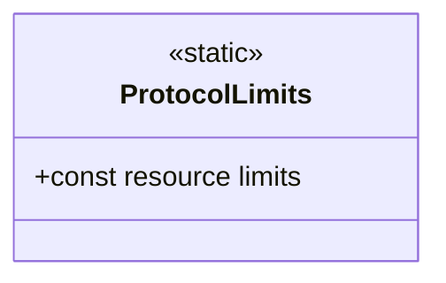

<!-- The Singularity Workshop moniker -->

# ProtocolLimits — UML and use cases

## Class neighborhood

## Use case

1. Construct a definition or payload through the public API.
2. The owning type checks collection and text limits before retaining the input.
3. The caller receives a clear argument or invalid-operation error when a bound is exceeded.

## Boundary

The limits bound representation size. They do not validate application meaning, provider behavior, permissions, or downstream execution.

---

<!-- THE SINGULARITY WORKSHOP FOOTER -->

