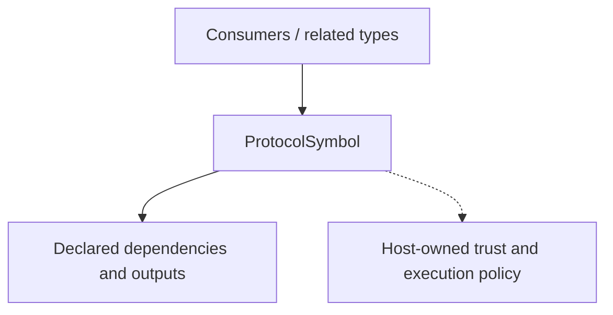

<!-- The Singularity Workshop moniker -->

# ProtocolSymbol — UML neighborhood and use cases

> **Target:** public readonly record struct ProtocolSymbol. This static neighborhood is authored from the current source and is not an execution trace or generated diagram.

## Neighborhood

### Source-backed relationships

- **Target source:** [ProtocolSymbol.cs](ProtocolSymbol.cs).
- **Related types:** ProtocolBuilder; ProtocolDefinition; ProtocolReference.
- **Package:** TheSingularityWorkshop.ProtocolAi; core API is provider-neutral and uses the .NET base class library.
- **Evidence scope:** current source declarations and named test files; no repository-wide relationship scanner is claimed.

## Use cases

### UC-1 — Use the type in a host-owned protocol workflow

- **Actor:** application host or package consumer.
- **Goal:** represent, resolve, or inspect vocabulary data through the intended protocol contract.
- **Trigger:** the host defines a vocabulary or receives protocol-qualified data.
- **Preconditions:** the host selects the expected protocol definition and identity version.
- **Outcome:** the type provides its declared contract without contacting a model provider or executing application behavior.
- **Failure/alternative:** invalid or undefined identities are rejected at the relevant construction/validation boundary; unknown text remains literal where the API explicitly supports that case.
- **Evidence/status:** authored use case grounded in source and test names; not inferred automatically from syntax.

### UC-2 — Diagnose an invalid reference or payload

- **Actor:** application developer or test.
- **Goal:** distinguish wrong-protocol, undefined-symbol, malformed-payload, and literal-value cases.
- **Trigger:** a consumer validates or resolves candidate data.
- **Outcome:** the consumer receives a deterministic value or a documented exception.
- **Failure/alternative:** reject and report the invalid input; do not invent a symbol mapping or treat successful parsing as authorization.
- **Evidence/status:** source-checked against tests/ProtocolAi.Tests/ProtocolDefinitionTests.cs.

## Detail levels

- **Collapsed:** ProtocolSymbol and declaration kind.
- **Contract:** public members and data types in the linked source file.
- **Implementation:** linked source file; this static page is not interactively expandable.

## Related pages

- [Type guide](./ProtocolSymbol.md)
- [Documentation index](DOCUMENTATION_INDEX.md)
- [Shared Workshop documentation standard](https://github.com/TrentBest/TheSingularityWorkshop.FSM_COS/blob/development/DOCUMENTATION_STANDARD.md)

---

<!-- THE SINGULARITY WORKSHOP FOOTER -->

