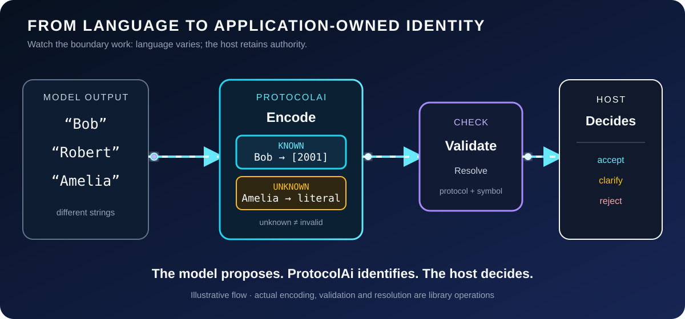
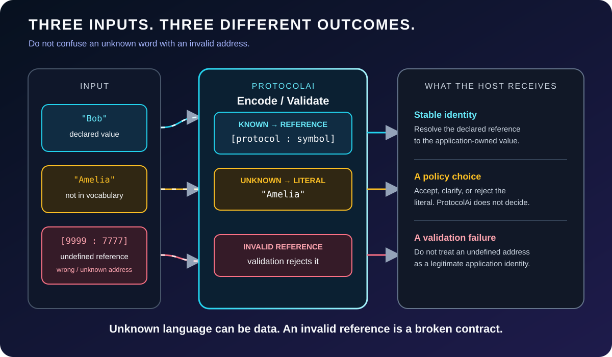

# ✳️ 00 The Singularity Workshop — ProtocolAi

> **Language can wander. Application-owned identity needs an address.**

An LLM can produce several plausible expressions for one intent. Those differences are not automatically hallucinations; the engineering problem appears when an application mistakes variable language for stable identity. ProtocolAi gives known concepts deterministic integer-backed addresses and preserves unknown values as literals for the host to decide.

  

The picture is a first glance, not the whole lesson: the animated flow in **03 How** makes the decision boundary visible, and **04 See it in a minute** lets you step through the actual C# behavior.

## 🟦 01 What

**TheSingularityWorkshop.ProtocolAi** is a small, provider-neutral .NET library for defining application-owned vocabularies.

- A known string maps to its declared symbol ID.
- A reference identifies both a protocol and a symbol.
- Unknown values remain literals rather than silently receiving identities.
- Validation rejects payloads that use the wrong protocol or undefined references.
- Resolution converts valid references back to application-facing values.

The package contains no model, provider SDK, prompt engine, grammar compiler, transport client, or command executor.

## 🟣 02 Why

The model proposes. **ProtocolAi identifies. The host decides.**

A string is language. An integer reference is an address in a vocabulary the application owns. That boundary makes identity explicit without claiming that the model itself becomes deterministic or that hallucinations disappear.

An unknown literal is not automatically invalid. The host may accept it, reject it, ask for clarification, or propose a registration workflow. ProtocolAi deliberately does not choose that policy.

## 🔺 03 How

*Follow the moving signals from language to identity. The animation is illustrative; the encoding, validation, and resolution below are real library operations.*

#### Three outcomes, made visible

This second view separates three cases that are easy to blur together: **known identity**, **unknown input**, and **invalid reference**. Only the host decides what to do with an unknown literal; validation protects the reference contract.

The vocabulary is defined by the application:

~~~csharp
using TheSingularityWorkshop.ProtocolAi;

var people = new ProtocolBuilder(1001, "People")
    .Define(2001, "bobId", "Bob")
    .Define(2002, "janeId", "Jane")
    .Define(2003, "saraId", "Sara")
    .Build();

var payload = people.Encode(["Bob", "Jane", "Amelia"]);
people.Validate(payload);

var resolved = people.Resolve(payload);
// ["Bob", "Jane", "Amelia"]
// Bob and Jane were references; Amelia remained a literal.
~~~

**ProtocolAi answers WHAT a known identity is.** [GrammarAi](https://github.com/TrentBest/TheSingularityWorkshop.GrammarAi) is the companion for composing semantic primitives into structured grammar. The host owns policy and execution.

## 🟢 04 See it in a minute

### Play the living documentation

The interactive playground embeds the behavior being explained. It uses the real ProtocolAi C# library, while FSM_API drives the visible state progression.

From the repository root, with the .NET 8 SDK installed:

~~~powershell
dotnet run --project samples/ProtocolAi.Playground/ProtocolAi.Playground.csproj
~~~

The playground lets you:

- compare multiple illustrative candidate responses to the same intent;
- replay a second fixture batch and inspect wording, semantic, and shape variation;
- release a concept through the encoding, validation, and resolution stages;
- compare a known value, an unknown literal, and an intentionally invalid reference;
- step the actual FSM_API-driven flow one transition at a time;
- inspect the live ProtocolPayload and resolved value;
- explore the conceptual relationship between ProtocolAi and GrammarAi.

The candidate responses are clearly labelled fixtures—not live model output or measured probabilities. The visual experiment uses inspectable SVG, following the educational approach in [Visualize](https://github.com/TrentBest/TheSingularityWorkshop.Visualize); it does not claim to execute Visualize's C# backend or a production GPU renderer.

### The smallest useful example

Install the current published version listed on [NuGet](https://www.nuget.org/packages/TheSingularityWorkshop.ProtocolAi), then define a vocabulary, encode values, validate the payload, and resolve it. Unknown values remain literals. See [Consuming ProtocolAi](docs/CONSUMING.md) for a complete guide.

## 🟪 05 Documentation and theory

- [Consuming ProtocolAi](docs/CONSUMING.md) — installation, first vocabulary, encoding, validation, resolution, and host integration.
- [ProtocolAi Examples](docs/EXAMPLES.md) — practical domain examples.
- [AI Exchange](docs/AI_EXCHANGE.md) — provider-neutral exchange boundaries.
- [ProtocolAi Theory](docs/THEORY.md) — the semantic and architectural argument.
- [ProtocolAi Reflection](docs/REFLECTION.md) — limitations, lifecycle questions, and future directions.
- [Ecosystem Integration](docs/ECOSYSTEM_INTEGRATION.md) — boundaries with FSM_UserIO, GrammarAi, FSM_COS, GUI, serialization, and ontology.
- [Semantic Payload JSON](docs/PROTOCOL_PAYLOAD_JSON.md) — the dependency-free JSON wire representation, including what transport does and does not validate.
- [Guides for every starting point](docs/GUIDES.md) — a plain-language introduction, beginner walkthrough, C# integration guide, and deeper developer guide.
- [NuGet package](https://www.nuget.org/packages/TheSingularityWorkshop.ProtocolAi) · [Source](https://github.com/TrentBest/TheSingularityWorkshop.ProtocolAi) · [Issues](https://github.com/TrentBest/TheSingularityWorkshop.ProtocolAi/issues)

### Build, test, and pack

~~~powershell
dotnet restore TheSingularityWorkshop.ProtocolAi.slnx
dotnet build TheSingularityWorkshop.ProtocolAi.slnx --configuration Release
dotnet test TheSingularityWorkshop.ProtocolAi.slnx --configuration Release
dotnet pack TheSingularityWorkshop.ProtocolAi.csproj --configuration Release --output ./artifacts
~~~

NuGet publication remains disabled by default and requires an explicit Workshop decision.

---

  

  <em>The Singularity Workshop — Tools for the curious, the bold, and the systemically inclined.</em> 
  <strong>Because state shouldn't be a mess.</strong>

