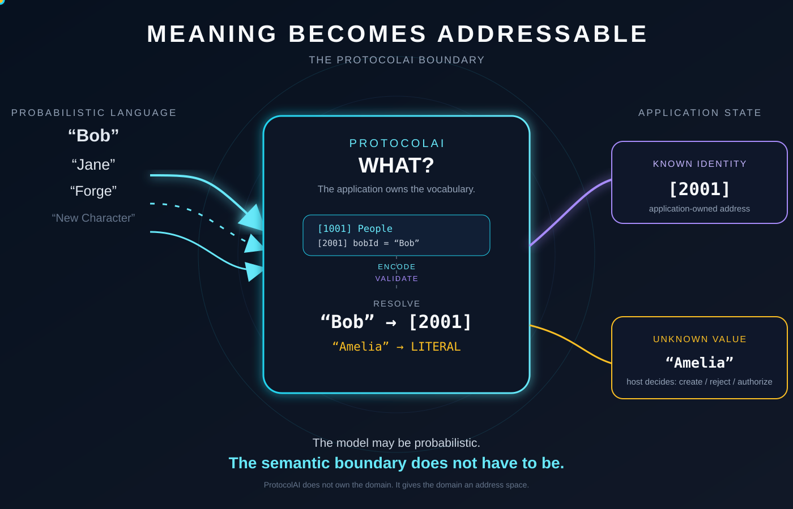

<!-- The Singularity Workshop moniker -->

  

# ✳️ 00 The Singularity Workshop — ProtocolAi

> **An LLM can propose a program. Your application must own what its instructions mean.**

LLMs are powerful at proposing ideas and structures, but their output is not a stable application contract. A name can drift, an identifier can be invented, and a plausible-looking response can still ask for the wrong thing.

**ProtocolAi gives known concepts application-owned integer addresses.** Unknown values stay visible as literals; undefined references can be rejected. Compose those stable semantic primitives with [GrammarAi](https://github.com/TrentBest/TheSingularityWorkshop.GrammarAi), then let your host validate, authorize, and interpret the resulting program.

  

The idea in one line:

**The model proposes. ProtocolAi identifies. GrammarAi structures. Your host decides and executes.**

## 🟣 01 — Why

A language model may return different wording for the same intent, or an invented identifier. The application still needs a stable contract for what each value means.

Your application controls the semantic contract it accepts.

Give the model a vocabulary of application-owned identities. When a candidate comes back, resolve known references against the expected definition, keep unknown literals explicit, and reject undefined references. The model remains probabilistic; the application's interpretation boundary becomes deterministic.

This does **not** prove the model understood the user, guarantee it will choose the correct integer, or make an authorized command safe. Those require additional validation, host policy, and testing.

**Explore the Workshop:** [Find packages on NuGet](https://www.nuget.org/packages?q=TheSingularityWorkshop) · [Browse the repository guide](https://github.com/TrentBest/TheSingularityWorkshop.FSM_COS/blob/development/docs/WORKSHOP_REPOSITORIES.md)

## 🟦 02 — What

**TheSingularityWorkshop.ProtocolAi** is a small, provider-neutral .NET library for defining application-owned vocabularies.

- A recognized value maps to a stable, protocol-qualified integer reference.
- A reference is checked against the vocabulary that owns its meaning.
- An unknown value remains a literal instead of silently becoming a known identity.
- A reference to an undefined symbol—or to the wrong protocol—can be rejected.
- Valid references resolve through the application's definition.

The integer is an **address**, not the meaning itself. The application owns the mapping and must preserve the meaning of an identity once published.

ProtocolAi does not contain a model, provider SDK, prompt engine, grammar compiler, authorization system, or command executor.

## 🔺 03 How

*Follow the moving signals from language to identity. The animation is illustrative; the encoding, validation, and resolution below are real library operations.*

### Three outcomes, not one vague “AI result”

| Candidate | ProtocolAi outcome | What happens next |
|---|---|---|
| Known value | Qualified integer reference | Validate and resolve using the expected definition |
| Unknown value | Literal | Host policy decides: retain, clarify, register, or reject |
| Undefined or wrong-protocol reference | Validation failure | Do not treat it as an owned identity |

A minimal example:

~~~csharp
using TheSingularityWorkshop.ProtocolAi;

var people = new ProtocolBuilder(1001, "People")
    .Define(2001, "bobId", "Bob")
    .Define(2002, "janeId", "Jane")
    .Define(2003, "saraId", "Sara")
    .Build();

var payload = people.Encode(["Bob", "Jane", "Amelia"]);
people.Validate(payload);

var resolved = people.Resolve(payload);
// ["Bob", "Jane", "Amelia"]
// Bob and Jane are known references; Amelia remains a literal.
~~~

### From integer primitives to an executable program

ProtocolAi is the identity layer, not the whole execution engine. The larger composition is:

~~~text
LLM proposal
    ↓
parse the returned representation
    ↓
GrammarAi checks structure
    ↓
ProtocolAi checks semantic identities
    ↓
host policy checks permissions and context
    ↓
bounded interpreter performs approved operations
~~~

The current library provides vocabulary definitions, stable identities, value encoding, payload resolution, and JSON representation. `ProtocolDefinition.CompareCompatibility(candidate)` also reports structural changes between a baseline and candidate: a changed protocol ID, removed symbol IDs, or changed names/values for existing symbol IDs. Adding new symbol IDs is compatible under this structural check. A host still owns grammar interpretation, authorization, and execution; the report cannot prove that domain meaning stayed the same.

## 🟢 04 See it in a minute

### Play the living documentation

The interactive playground embeds the behavior being explained. It uses the real ProtocolAi C# library, while FSM_API drives the visible state progression.

From the repository root, with the .NET 8 SDK installed:

~~~powershell
dotnet run --project samples/ProtocolAi.Playground/ProtocolAi.Playground.csproj
~~~

The playground lets you:

- compare illustrative candidate responses and see how wording can drift;
- release a candidate through encoding, validation, and resolution;
- compare a known value, an unknown literal, and an intentionally invalid reference;
- step the FSM_API-driven flow one transition at a time;
- inspect the live ProtocolPayload and resolved value;
- explore the conceptual relationship between ProtocolAi and GrammarAi;
- try the size-aware SVG Hello World at `/hello`.

The candidate responses are labelled fixtures—not live model output or measured probabilities. The SVGs are living documentation, not a claim that a production GPU renderer is executing.

## 🟪 05 The math and the next layer

The guarantees are deliberately narrow and useful: for a fixed, unambiguous vocabulary, encoding is deterministic; a reference passes validation only if its protocol and symbol are defined; and resolution uses the application-owned definition.

For the deeper model, see [ProtocolAi Theory](https://github.com/TrentBest/TheSingularityWorkshop.ProtocolAi/blob/development/docs/THEORY.md).

- [Gallery](https://github.com/TrentBest/TheSingularityWorkshop.ProtocolAi/blob/development/docs/GALLERY.md) — the visual tour, artifact classifications, and links from each diagram to executable evidence.
- [Living Documentation](https://github.com/TrentBest/TheSingularityWorkshop.ProtocolAi/blob/development/docs/LIVING_DOCUMENTATION.md) — the animated SVGs, interactive playground, accessibility, and the distinction between illustration and executable behavior.
- [Consuming ProtocolAi](https://github.com/TrentBest/TheSingularityWorkshop.ProtocolAi/blob/development/docs/CONSUMING.md) — installation and first integration.
- [ProtocolAi Examples](https://github.com/TrentBest/TheSingularityWorkshop.ProtocolAi/blob/development/docs/EXAMPLES.md) — practical domain examples.
- [Ecosystem Integration](https://github.com/TrentBest/TheSingularityWorkshop.ProtocolAi/blob/development/docs/ECOSYSTEM_INTEGRATION.md) — boundaries with FSM_UserIO, GrammarAi, FSM_COS, GUI, serialization, and ontology.
- [Semantic Payload JSON](https://github.com/TrentBest/TheSingularityWorkshop.ProtocolAi/blob/development/docs/PROTOCOL_PAYLOAD_JSON.md) — dependency-free wire representation and transport limits.
- [Guides for every starting point](https://github.com/TrentBest/TheSingularityWorkshop.ProtocolAi/blob/development/docs/GUIDES.md) — plain-language, beginner, C# integration, and developer guides.
- [NuGet package](https://www.nuget.org/packages/TheSingularityWorkshop.ProtocolAi) · [Source](https://github.com/TrentBest/TheSingularityWorkshop.ProtocolAi) · [Issues](https://github.com/TrentBest/TheSingularityWorkshop.ProtocolAi/issues)

### Build, test, and pack

~~~powershell
dotnet restore TheSingularityWorkshop.ProtocolAi.slnx
dotnet build TheSingularityWorkshop.ProtocolAi.slnx --configuration Release
dotnet test TheSingularityWorkshop.ProtocolAi.slnx --configuration Release
dotnet pack TheSingularityWorkshop.ProtocolAi.csproj --configuration Release --output ./artifacts
~~~

NuGet publication remains disabled by default and requires an explicit Workshop decision.

---

  

   

  <em>The Singularity Workshop — Tools for the curious, the bold, and the systemically inclined.</em> 
  <strong>Because state shouldn't be a mess.</strong>

## Find ProtocolAi in the Workshop

[Documentation index](https://github.com/TrentBest/TheSingularityWorkshop.ProtocolAi/blob/development/DOCUMENTATION_INDEX.md) · [Consuming guide](docs/CONSUMING.md) · [Gallery](docs/GALLERY.md)

For integration, start with the [Consuming ProtocolAi guide](https://github.com/TrentBest/TheSingularityWorkshop.ProtocolAi/blob/development/docs/CONSUMING.md).
The [cross-repository usage map](https://github.com/TrentBest/TheSingularityWorkshop.ProtocolAi/blob/development/docs/ECOSYSTEM_USAGE_MAP.md) links to real consumer files, includes focused code excerpts, and distinguishes implemented integrations from candidates and legacy code. Start with [AnyApp's host-owned semantic exchange](https://github.com/TrentBest/AnyApp/blob/master/WorkshopSemanticExchange.cs) to see ProtocolAi paired with GrammarAi and FSM_UserIO without reversing dependency direction.

---

  

  <a href="https://github.com/TrentBest">GitHub</a> ·
  <a href="https://coderlegion.com/">Coder Legion</a> ·
  <a href="https://www.patreon.com/c/TheSingularityWorkshop">Patreon</a> ·
  <a href="https://www.paypal.com/donate/?hosted_button_id=3Z7263LCQMV9J">PayPal</a>
   
  <a href="https://github.com/TrentBest/FSM_API">FSM_API</a> ·
  <a href="https://github.com/TrentBest/TheSingularityWorkshop.FSM_Serialization">FSM_Serialization</a> ·
  <a href="https://github.com/TrentBest/WebPage">WebPage</a>

<em>The Singularity Workshop — Tools for the curious, the bold, and the systemically inclined.</em> <strong>Because state shouldn't be a mess.</strong> <em>And because static boundaries are invitations to cause trouble.</em>

