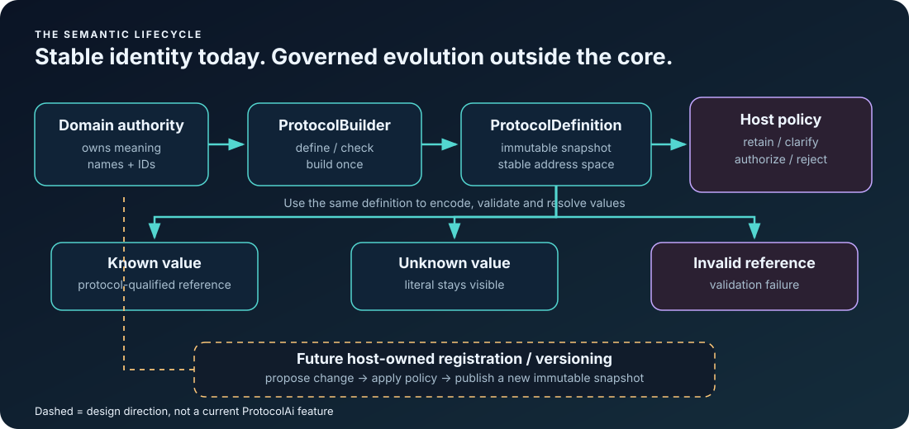

<!-- The Singularity Workshop moniker -->

  

# ProtocolAi Domain Audit and Roadmap

> **Current assessment:** the core abstraction and teaching material are substantially present. The main remaining work is to tighten the published contract, connect real consumers consistently, verify behavior and packaging, and decide the lifecycle questions without bloating the core.

## Domain map

The diagram separates implemented behavior from a future direction. The solid path is the current model: the domain owns meaning, ProtocolBuilder creates a definition, and the definition encodes/validates/resolves. The dashed path is a design question, not an existing API.

## What the current documentation already covers

- **First contact:** README explains the problem, WHAT / WHY / HOW, and links to the interactive local playground.
- **Learning paths:** non-technical, beginner, C# developer, general developer, AI exchange, examples, theory, reflection, consumption, and release-readiness guides.
- **Core semantics:** application-owned protocol IDs and symbol IDs; known values become qualified references; unknown values remain literals; undefined or wrong-protocol references are invalid.
- **Transport:** ProtocolPayloadJson documents the explicit reference-versus-literal wire representation.
- **Theory:** mathematical foundations state narrow determinism and validation properties while explicitly not proving model correctness, authorization, or safe execution.
- **Visual learning:** the money shot, living flow, three-outcome comparison, and new lifecycle diagram explain different levels of the abstraction.
- **Executable learning:** the local Blazor WebAssembly playground calls the real C# library; candidate cloud responses are fixtures, not live LLM output. Its FSM_API-driven stage progression is a sample, not a hosted production service.
- **Ecosystem orientation:** [ECOSYSTEM_USAGE_MAP.md](ECOSYSTEM_USAGE_MAP.md) distinguishes confirmed source usage, indirect carrier boundaries, candidate integrations, and legacy code.

## Findings: what is missing or needs a decision

### P0 — contract correctness and evidence

- [ ] Run a clean .NET 8 restore, Release build, and full test suite on the current development commit; record exact results and commit.
- [ ] Browser-test the playground's primary flow, invalid-reference path, reset/step behavior, and /hello route.
- [ ] Check every public API against its tests and XML documentation: null handling, empty inputs, exception types, duplicate names/IDs/values, ordinal matching, numeric overflow, and wrong-protocol references.
- [ ] Review ProtocolPayloadJson for malformed shapes, missing fields, unknown fields, integer overflow, duplicate values, and round-trip compatibility.
- [ ] Confirm generated NuGet package contents: README, license, symbols/source package policy, target framework support, examples, and whether docs/images are included intentionally.
- [ ] Reconcile install instructions with the actually published NuGet version. The development project declares 0.1.0-alpha.3; this does not prove the same version is published.
- [ ] Keep NuGet publication disabled until explicitly authorized.

### P1 — consumer truth and navigation

- [ ] Keep the [ecosystem usage map](ECOSYSTEM_USAGE_MAP.md) aligned with active source branches, real API calls, and tests.
- [ ] AnyApp is the strongest confirmed host example: its vocabulary lives in WorkshopSemanticExchange.cs and its package reference lives in AnyApp.csproj. Link both directions.
- [ ] GrammarAi references qualified symbols through GrammarProtocolReference; document this as a lightweight identity seam, not a mandatory package dependency.
- [ ] FSM_UserIO carries SemanticIntent and optional ProtocolId. Explain why the primitive boundary is useful and why FSM_UserIO should not depend upward on ProtocolAi.
- [ ] FSM_COS is an indirect carrier through FSM_UserIO, not a reason for a direct ProtocolAi dependency.
- [x] Verified WebPage's composition-level example in [WorkshopCompositionTests.cs](https://github.com/TrentBest/WebPage/blob/master/SingularityHub.Tests/WorkshopCompositionTests.cs): it composes ProtocolAi and GrammarAi through FSM_COS and tests the resulting exchange/dependency closure. This is composition-level use, not proof that the WebPage application project directly references the ProtocolAi package.
- [ ] Review the separate legacy implementation in The/Architect/Workshop/Ai/ProtocolAi.cs. Decide explicitly whether it remains isolated or is migrated; do not assume it is the NuGet API.
- [ ] For each consumer promoted to confirmed usage, add a source path, small code excerpt, explanatory image only where useful, and a test link when a test exists.

### P2 — API design questions before 1.0

- [ ] **Identity compatibility:** define whether protocol IDs and symbol IDs are permanent, whether removed IDs can ever be reused, and how semantic changes are versioned.
- [ ] **Definition versioning:** decide whether ProtocolDefinition needs a separate schema/version identifier or whether protocol identity plus externally managed versioning is sufficient.
- [ ] **Unknown-value lifecycle:** keep Encode's literal behavior explicit. Decide whether registration belongs in a separate host-owned registry/allocator package; do not mutate a built definition in place.
- [ ] **Cross-version compatibility:** define how a receiver responds to an unknown symbol, removed symbol, renamed display value, or incompatible protocol revision.
- [ ] **Canonicalization:** document case sensitivity, Unicode normalization, whitespace handling, aliases, and whether a host should canonicalize before Encode. Avoid implicit normalization that changes identity unexpectedly.
- [ ] **Serialization contract:** specify forward-compatibility expectations for JSON, including unknown fields and unsupported payload versions.
- [ ] **Reference ergonomics:** evaluate whether APIs need a single canonical qualified-reference format for logs, diagnostics, JSON, and GrammarAi bridges.
- [ ] **Public API surface:** confirm which helpers are necessary for the core and which are sample conveniences. Do not add types solely because they appear in the roadmap.

### P3 — useful extensions only after evidence

- [ ] A small cross-version compatibility checker if multiple real consumers need it.
- [ ] A host-owned registry/allocator abstraction if dynamic registration is a real requirement across more than one consumer.
- [ ] Golden protocol fixtures so independent consumers can test the same identity and JSON contracts.
- [ ] A hosted browser playground so readers can try the library without installing the .NET SDK. Until a deployment is configured and tested, describe it as local-only.
- [ ] Data-driven visualization where a sample state/payload feeds the UI directly, reducing duplicated hard-coded behavior between SVG and C#.
- [ ] Measured comparisons for payload size or token usage only if a concrete application and repeatable baseline exist. Integer identities alone do not guarantee fewer tokens or better model behavior.

## Things ProtocolAi should not absorb

- LLM clients, API keys, provider-specific request/response formats, prompt orchestration, or tokenizers.
- Grammar production rules or general program interpretation.
- Authorization, capability grants, user identity, or command execution.
- An implicit global registry that lets a model mint permanent symbols.
- Mutable definitions whose meaning can silently change after consumers have cached references.
- GUI or Renderer dependencies in the core package.

## Recommended order of work

1. Finish the cross-repository source audit and correct any stale claims/links.
2. Verify the current build, tests, playground, API contracts, and package contents.
3. Decide identity/version compatibility and unknown-value lifecycle before stabilizing the public API.
4. Add shared fixtures or a compatibility test only where two real consumers need them.
5. Consider hosting the playground after the static deployment is actually configured and validated.
6. Make a release decision from evidence; do not treat documentation completeness as proof of API stability.

## Latest development evidence — 2026-11-01

Protocol definitions, payloads, and JSON representations now enforce explicit per-item and aggregate resource limits. The JSON reader checks the encoded-size bound and values-array count before materializing wire records; payload construction also caps aggregate literal text. Companion type/UML documentation was added for `ProtocolLimits`.

The latest full development workflow [#306](https://github.com/TrentBest/TheSingularityWorkshop.ProtocolAi/actions/runs/41281681476) passed on commit [6fe1b53](https://github.com/TrentBest/TheSingularityWorkshop.ProtocolAi/commit/6fe1b5396a5c2afd3909cb1f34f8ea403912e97f): Release build, 39 ProtocolAi tests, 4 playground tests, package, and clean-consumer verification. Structural compatibility remains in open PR [#8](https://github.com/TrentBest/TheSingularityWorkshop.ProtocolAi/pull/8); no merge or publication has occurred.

## Status language

Use **implemented** only when active source and tests support the claim; **indirect boundary** when data is merely carried; **candidate** for a plausible use not present in current code; and **legacy review** for older implementations whose current status has not been established. This vocabulary prevents the roadmap from accidentally becoming an architecture claim.

---

  

  <a href="https://github.com/TrentBest">GitHub</a> ·
  <a href="https://coderlegion.com/">Coder Legion</a> ·
  <a href="https://www.patreon.com/c/TheSingularityWorkshop">Patreon</a> ·
  <a href="https://www.paypal.com/donate/?hosted_button_id=3Z7263LCQMV9J">PayPal</a>
   
  <a href="https://github.com/TrentBest/FSM_API">FSM_API</a> ·
  <a href="https://github.com/TrentBest/TheSingularityWorkshop.FSM_Serialization">FSM_Serialization</a> ·
  <a href="https://github.com/TrentBest/WebPage">WebPage</a>

<em>The Singularity Workshop — Tools for the curious, the bold, and the systemically inclined.</em> <strong>Because state shouldn't be a mess.</strong> <em>And because static boundaries are invitations to cause trouble.</em>

