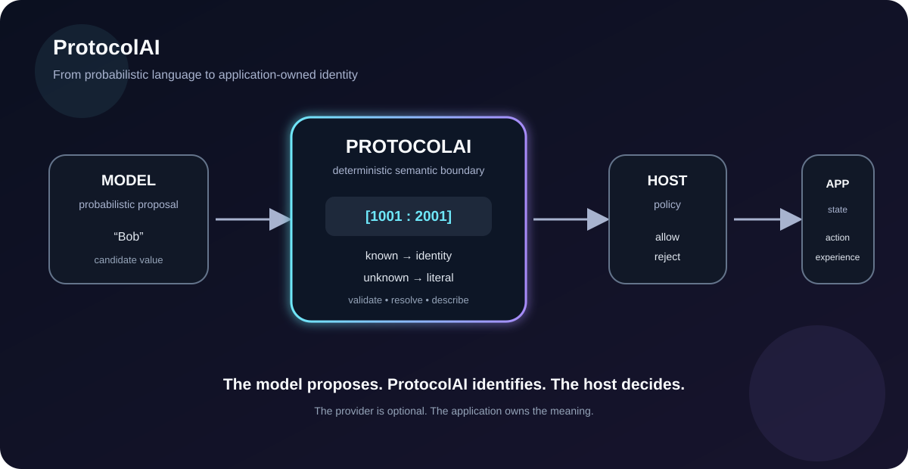

# ProtocolAi Gallery

ProtocolAi's visuals explain the semantic boundary: known values can become application-owned references, unknown values remain explicit literals, and invalid references are rejected by the protocol contract. The SVGs are explanatory artwork; their moving signals illustrate the concept rather than reporting live runtime state.

## Visual tour

### The money shot


This authored diagram introduces the application-owned vocabulary boundary; it is not a generated source graph.

### Follow the signal


These animated diagrams distinguish encoding, validation, resolution, and the host's decision. Animation is illustrative; executable behavior is in the library and its tests.

### Three outcomes and payload round-trip




The JSON representation transports protocol identity and values. It does not define application meaning, authorize actions, or contact an AI provider.

## See actual behavior

From the repository root:

```bash
dotnet run --project samples/ProtocolAi.Playground/ProtocolAi.Playground.csproj
dotnet test tests/ProtocolAi.Tests/ProtocolAi.Tests.csproj --configuration Release
```

The playground calls the real library; tests cover encoding, validation, resolution, immutability, and JSON edge cases. These commands are behavioral evidence; the SVGs are visual explanations.

## Detailed recipe

Start with [Living Documentation](LIVING_DOCUMENTATION.md), then follow the [consumer guide](CONSUMING.md), [JSON wire contract](PROTOCOL_PAYLOAD_JSON.md), [examples](EXAMPLES.md), and [release readiness checklist](RELEASE_READINESS.md).
