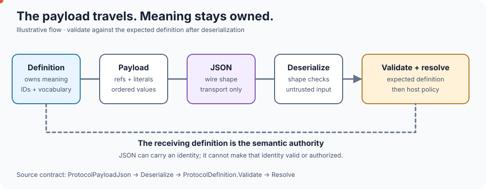

<!-- The Singularity Workshop moniker -->

  

# ProtocolAi Living Documentation

> **A diagram should teach a concept. A living diagram should let the reader watch the concept unfold.**

The README is the front door. Animated SVGs invite the reader in; the local playground lets the reader change inputs and inspect actual library results; the mathematical foundations explain exactly what is guaranteed and what is not.

## The reader's route

Notice the problem → watch language enter the boundary → see three distinct outcomes → run the C# implementation → inspect payload and resolution → read the proof and limits.

## Living images in this repository

### 1. The money shot — the whole idea at a glance

**Teaches:** the model may propose language; the application owns the vocabulary; known values become references and unknown values remain visible for host policy.

### 2. The living flow — follow the signal

**Teaches:** encoding, validation, and resolution are different operations. The moving signal is illustrative; the C# methods are the executable behavior.

### 3. Three outcomes — do not confuse the cases

- **Known value:** can map to an application-owned reference.
- **Unknown value:** remains literal data until the host decides what to do.
- **Invalid reference:** violates the protocol contract and should not be resolved as a valid identity.

### 4. The interactive playground — touch the actual behavior

From the repository root, run:

    dotnet run --project samples/ProtocolAi.Playground/ProtocolAi.Playground.csproj

Open the local URL printed by the .NET host. The playground uses the real ProtocolAi library. Its candidate responses are fixtures, not live LLM calls; FSM_API drives the sample's visible state progression. The /hello page is a separate size-aware SVG experiment.

### 4. The payload round trip — transport is not authority

**Teaches:** JSON transports a payload, but the receiving `ProtocolDefinition` remains the authority for semantic validation and resolution.

## What makes an image “living”?

A living image can use SVG animation to make time, movement, branching, or changing relationships visible. Here, animation is a teaching aid, not a source of truth.

Every visual should have:
- a specific learning objective;
- meaningful labels and a text explanation;
- enough contrast to read at ordinary README scale;
- a reduced-motion path;
- an explicit distinction between illustrative animation and executed library behavior;
- a route to the relevant source, test, or mathematical claim.

An animation that merely glows is decoration. An animation that lets a reader follow a value through a boundary is documentation.

## SVG versus interactive UI

| Layer | What it does | What it does not claim |
|---|---|---|
| Animated SVG in GitHub | Shows a concept unfolding over time | Does not execute the C# library |
| Local playground | Calls ProtocolAi and exposes state/payload results | Does not call a live LLM or measure hallucination rates |
| ProtocolAi library | Defines, encodes, validates, and resolves vocabulary identities | Does not own authorization or command execution |
| Host / interpreter | Applies domain policy and performs approved effects | Must not treat a valid ID alone as permission |

## Next experiments

These are directions, not claims of current implementation:

1. **Inspectable geometry:** select a stage and see the matching explanation, formula, and C# method.
2. **One concept, several views:** keep the same semantic model visible in the README SVG, interactive playground, and mathematical document.
3. **Data-led animation:** animate actual sample state and payload in the playground rather than duplicating behavior as hard-coded “proof” inside an SVG.
4. **Reusable Workshop patterns:** compare GUI.SVG, Renderer, and Visualize, then adopt only patterns that improve clarity without adding dependencies to ProtocolAi.
5. **Accessible by default:** retain text alternatives, reduced-motion support, and static meaning when animation is unavailable.

## The principle

**Make the boundary visible. Make the implementation inspectable. Make the claim smaller than the evidence—not larger.**

## Cross-repository lessons to bring back here

The Workshop's visual repositories suggest a useful distinction for ProtocolAi:

- **From Visualize + GUI.SVG:** when a diagram is generated from real C# geometry/contracts, document the source program and API handoff next to the output. Do not redraw a result and imply the backend produced it.
- **From the Visualize Primitive Gallery:** keep contract-backed output and browser-only experiments side by side, but label their different execution paths. A browser sandbox can be useful without pretending it is the same path as the C# implementation.
- **From Renderer:** show the representation appropriate to the reader's current question. Start with the high-level semantic boundary; reveal protocol IDs, payload structure, validation, and proof as the reader moves closer. Renderer calls this computational detail across Event Horizons; for documentation, it becomes progressive explanatory detail.
- **From the current ProtocolAi implementation:** use the actual library as the authority. An SVG can animate a known reference, literal, or rejection, but the interactive C# playground should produce the corresponding payload and validation result.

The concrete next step is to connect each major visual stage to its matching source method and test. That makes the image a map into the implementation, not a substitute for it.

---

  

  <a href="https://github.com/TrentBest">GitHub</a> ·
  <a href="https://coderlegion.com/">Coder Legion</a> ·
  <a href="https://www.patreon.com/c/TheSingularityWorkshop">Patreon</a> ·
  <a href="https://www.paypal.com/donate/?hosted_button_id=3Z7263LCQMV9J">PayPal</a>
   
  <a href="https://github.com/TrentBest/FSM_API">FSM_API</a> ·
  <a href="https://github.com/TrentBest/TheSingularityWorkshop.FSM_Serialization">FSM_Serialization</a> ·
  <a href="https://github.com/TrentBest/WebPage">WebPage</a>

<em>The Singularity Workshop — Tools for the curious, the bold, and the systemically inclined.</em> <strong>Because state shouldn't be a mess.</strong> <em>And because static boundaries are invitations to cause trouble.</em>

