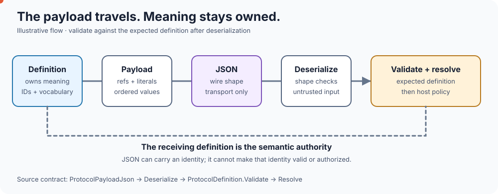

<!-- The Singularity Workshop moniker -->
<p align="center">
  <a href="https://github.com/TrentBest">
    
  </a>
</p>

# ProtocolAI Alpha 3 — Semantic Payload JSON

Alpha 3 adds a small, provider-neutral wire representation for `ProtocolPayload`.

The goal is deliberately modest:

> **Carry application-owned semantic identity across a boundary without making the transport layer responsible for meaning.**

This is a transport format, not an AI protocol, provider format, or authorization mechanism.

## Living diagram — transport is not authority



The payload may travel; the receiving `ProtocolDefinition` remains the authority for semantic validation and resolution. The animation illustrates this contract and does not execute the library.

## Wire shape

A payload has a protocol identity and an ordered list of values:

```json
{"protocolId":1001,"values":[{"symbolId":2001},{"literal":"New Character"}]}
```

The fields are:

| Field | Type | Meaning |
|---|---|---|
| `protocolId` | unsigned integer | The owning ProtocolAI namespace. |
| `values` | array | Ordered payload values. |
| `symbolId` | unsigned integer | A reference to an application-owned symbol. |
| `literal` | string | A value that has not been resolved to a symbol. |

Each value contains **exactly one** of `symbolId` or `literal`.

## Round trip

```text
ProtocolDefinition
      |
      v
ProtocolPayload
      |
      | Serialize
      v
      JSON
      |
      | transport
      v
      JSON
      |
      | Deserialize
      v
ProtocolPayload
      |
      | Validate
      v
ProtocolDefinition
      |
      | Resolve
      v
application values
```

The important point is that JSON does not become the authority for meaning.

After deserialization, the receiving application should validate the payload against the expected `ProtocolDefinition`.

## C# API

```csharp
var json = ProtocolPayloadJson.Serialize(payload);

var received = ProtocolPayloadJson.Deserialize(json);

protocol.Validate(received);

var values = protocol.Resolve(received);
```

The serializer has no provider dependency and no network behavior.

## Structural validation

Deserialization rejects malformed payload structure, including:

- null or empty JSON;
- invalid JSON;
- duplicate property names in any JSON object, including nested objects and arrays;
- a missing or zero protocol ID;
- a missing `values` array;
- a value containing both `symbolId` and `literal`;
- a value containing neither representation.

Duplicate property names are rejected rather than relying on a parser's choice of which repeated value to keep. Unknown, non-duplicate properties are ignored by the current deserializer; senders should still use the documented wire shape.

Deserialization deliberately does **not** decide whether a referenced symbol exists.

That is semantic validation and belongs to the receiving protocol definition:

```csharp
protocol.Validate(received);
```

This separation is important because a transport layer can preserve an identity it does not yet know.

## Unknown is not invalid

Consider:

```json
{"protocolId":1001,"values":[{"symbolId":2001},{"literal":"Amelia"}]}
```

`Amelia` is a valid literal even if protocol 1001 has never heard of Amelia.

By contrast:

```json
{"protocolId":1001,"values":[{"symbolId":9999}]}
```

may be structurally valid JSON but semantically invalid for the receiving protocol if symbol 9999 is undefined.

That distinction is intentional:

```text
known + valid reference  -> deterministic identity
unknown + literal        -> host policy
invalid reference        -> validation failure
```

## Canonical serialization

Alpha 3 emits a stable field order:

```text
protocolId
values
    symbolId OR literal
```

The representation is intended to be predictable and compact. Consumers should treat it as a ProtocolAI transport representation rather than depending on incidental JSON formatting beyond the documented field semantics.

## Compatibility and persisted definitions

Alpha 3 does not put a definition revision or fingerprint into every payload. The wire data identifies the protocol namespace and carries ordered symbol references or literals; it does **not** identify the exact historical `ProtocolDefinition` that produced it.

The receiving host must therefore select the trusted definition against which a payload is validated. If the host needs historical interpretation, it must retain and select the corresponding immutable definition itself (for example, by storing a definition revision beside the payload in host-owned persistence metadata). ProtocolAI does not provide a definition registry, revision store, or automatic migration service.

Structural compatibility can help a host decide whether a candidate definition can read older payloads:

- An additive candidate can resolve payloads written against the older definition, provided existing symbol IDs retain their meanings.
- An older definition rejects a payload that references a symbol ID introduced only by a newer definition.
- Removing or redefining an existing symbol is structurally incompatible; the host must retain the old definition or perform an explicit, domain-aware migration.

The comparison is not a semantic proof. A host must preserve the meaning of published IDs and must not silently reinterpret historical data. Compatibility checks also do not replace authentication, authorization, or migration review.

Future negotiation or definition-version metadata can be added above this representation without changing the meaning of `ProtocolPayload`. Adding a revision field to this wire format would itself be a wire-contract change and should be introduced only if the core package is explicitly made responsible for selecting historical definitions.

## Security boundary

JSON parsing is not authorization.

Successful deserialization means:

> “This data has the expected structural shape.”

Successful protocol validation means:

> “These references are defined by the expected vocabulary.”

Neither means:

> “The sender is authorized to perform the operation represented by these values.”

Authorization, authentication, replay protection, and execution policy remain host responsibilities.

## What this format deliberately does not contain

It does not contain:

- model/provider information;
- API keys;
- prompts;
- HTTP metadata;
- authorization decisions;
- execution commands;
- dynamic symbol allocation;
- grammar definitions;
- GUI state.

Those belong to higher-level exchange or application layers.

## Design rule

> **Transport should carry meaning without becoming the owner of meaning.**

That is the reason Alpha 3 adds JSON here instead of embedding a provider-specific exchange protocol inside ProtocolAI.

---

<p align="center"></p>

<p align="center">
  <a href="https://github.com/TrentBest">GitHub</a> ·
  <a href="https://coderlegion.com/">Coder Legion</a> ·
  <a href="https://www.patreon.com/c/TheSingularityWorkshop">Patreon</a> ·
  <a href="https://www.paypal.com/donate/?hosted_button_id=3Z7263LCQMV9J">PayPal</a>
  <br>
  <a href="https://github.com/TrentBest/FSM_API">FSM_API</a> ·
  <a href="https://github.com/TrentBest/TheSingularityWorkshop.FSM_Serialization">FSM_Serialization</a> ·
  <a href="https://github.com/TrentBest/WebPage">WebPage</a>
</p>

<p align="center"><em>The Singularity Workshop — Tools for the curious, the bold, and the systemically inclined.</em><br><strong>Because state shouldn't be a mess.</strong><br><em>And because static boundaries are invitations to cause trouble.</em></p>
