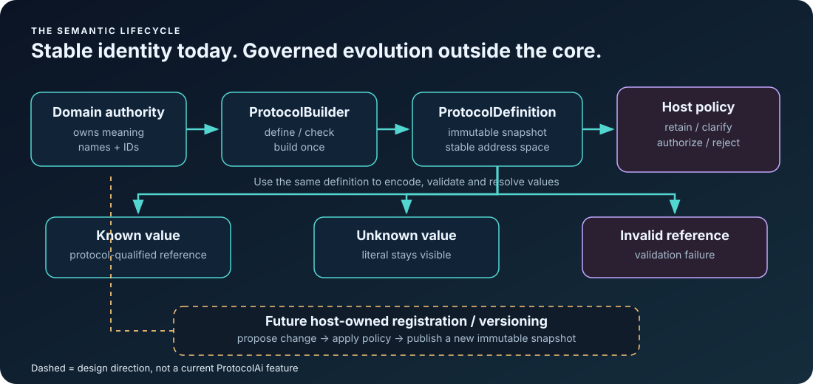

<!-- The Singularity Workshop moniker -->

  

# ProtocolAi Release Readiness

## Branch reconciliation

See [BRANCH_RECONCILIATION.md](BRANCH_RECONCILIATION.md) for the evidence-backed `master`/`development` comparison and preservation checklist. It is an audit record, not permission to merge or delete branches.

## Current review checkpoint — 2026-11-05 UTC

Start with the [Release Review Brief](RELEASE_REVIEW_BRIEF.md) for the concise contract, package boundaries, top remaining risks, and guided reading order. It is a review aid, not authorization to publish.

Current verified development checkpoint: [f6e2189b2f263a4a155e08edcc43c378f9a79f31](https://github.com/TrentBest/TheSingularityWorkshop.ProtocolAi/commit/f6e2189b2f263a4a155e08edcc43c378f9a79f31). Exact-head CI evidence: [workflow run #41947386308](https://github.com/TrentBest/TheSingularityWorkshop.ProtocolAi/actions/runs/41947386308), conclusion **success**. Restore, build, tests/coverage, package creation, packaged-documentation-path verification, and clean-consumer installation passed. The NuGet publish job was skipped. This checkpoint verifies the code and documentation at that SHA; any subsequent commit requires a new exact-head run.

The previous 75% estimate is retired: it was a qualitative estimate from the October review and is not a current measured readiness metric.

## Current package status

The project file on development declares version **0.1.0-alpha.3**. Treat the repository as pre-1.0 until a release decision is made. This document does not publish a package or change the version.

ProtocolAi is small, but a small codebase is not automatically a stable contract. Moving to 1.0.0 means consumers can reasonably depend on the public API and its semantics.

## Latest verified CI baseline — 2026-11-05 UTC

Latest green `development` commit: `f6e2189b2f263a4a155e08edcc43c378f9a79f31`. [Workflow run #41947386308](https://github.com/TrentBest/TheSingularityWorkshop.ProtocolAi/actions/runs/41947386308) passed for this exact commit, including restore, build, tests/coverage, package creation, packaged documentation-path verification, and clean consumer installation. The publication job was skipped.

This is not publication approval. Any update to this readiness document must itself pass CI before its new head is treated as verified.

## Visual companion

Release readiness is not just whether the happy path works: reviewers must verify each outcome, transport boundary, host-policy separation, and the claims made by the documentation.

## What is already a strong foundation

- Provider-neutral .NET library; no model SDK is required.
- Application-owned vocabulary with nonzero protocol and symbol identities.
- Duplicate symbol IDs, names, and values are rejected at definition build time.
- Immutable definition snapshot after build.
- Known values encode as symbol references; unknown values remain explicit literals.
- Payload validation checks protocol scope and rejects undefined symbol IDs.
- Resolution preserves ordering and literals.
- Deterministic self-description.
- JSON transport has explicit reference-versus-literal representation.
- Tests cover core mapping, duplicate definitions, invalid references, resolution, and JSON round trips.
- README, guides, theory index, semantic identity chapter, payload transport/validation chapter, event-envelope chapter, mathematical foundations, and animated SVGs explain the boundaries.

These are meaningful foundations, not proof of release readiness by themselves.

## Before removing alpha

### Correctness and API contract

- [x] Run full solution restore, Release build, and all tests in a clean environment (workflow run #39716469730).
- [ ] Verify the playground builds and run the visible flows in a browser.
- [ ] Review every public API for argument validation, exception types, XML docs, and naming consistency.
- [ ] Confirm malformed, cross-protocol, undefined, and empty-input behavior is intentional and tested.
- [ ] Review JSON compatibility: unknown fields, malformed shapes, numeric overflow, and compatibility expectations.
- [ ] Confirm no mutable collection or builder mutation can change a previously built definition.
- [x] The solution build includes the quick-start and playground projects; the clean consumer smoke test passed in workflow run #39716469730. Browser-level visual review remains outstanding.

### Package and consumer experience

- [ ] Review target frameworks against intended consumers; the current project declares .NET 8 only.
- [ ] Inspect the generated NuGet package, including README, license, symbols, and intended documentation assets.
- [ ] Verify package metadata and release notes describe current behavior rather than aspirations.
- [ ] Check every install snippet and package-version reference for staleness.
- [ ] Decide the compatibility/versioning policy for protocol IDs and symbol meanings.
- [x] Build, tests, package creation, packaged documentation-path verification, and clean consumer installation passed in exact-head workflow run #41947386308.
- [x] NuGet publication is explicitly disabled in the workflow pending the owner's authorization.

### Evidence and claims

- [ ] Keep mathematical guarantees aligned with implementation and tests.
- [ ] Do not claim fewer hallucinations, improved task success, or token savings without controlled measurements.
- [ ] State clearly that valid identity is not authorization and integer output alone is not safe execution.
- [ ] Keep animated diagrams labelled as illustrative unless driven by live sample state.

## Release decision

**Recommendation: not yet enough evidence to remove the alpha label.** The conceptual scope is focused and the implementation is approachable; the missing confidence is release verification and explicit API/compatibility review, not a need to turn ProtocolAi into a large framework.

1. Close the checklist, starting with clean CI and browser verification.
2. Make behavior-changing API corrections before stabilizing.
3. Decide supported target frameworks and the identity/versioning contract.
4. If the checks pass and the API is intentionally stable, prepare a reviewed 1.0.0 package.
5. Publish only after explicit authorization.

No item should be marked complete merely because a workflow exists or a document says it should work.

---

<!-- THE SINGULARITY WORKSHOP FOOTER -->

  <a href="https://github.com/TrentBest">GitHub</a> ·
  <a href="https://coderlegion.com/">Coder Legion</a> ·
  <a href="https://www.patreon.com/c/TheSingularityWorkshop">Patreon</a> ·
  <a href="https://www.paypal.com/donate/?hosted_button_id=3Z7263LCQMV9J">PayPal</a>
   
  <a href="https://github.com/TrentBest/FSM_API">FSM_API</a> ·
  <a href="https://github.com/TrentBest/TheSingularityWorkshop.FSM_Serialization">FSM_Serialization</a> ·
  <a href="https://github.com/TrentBest/WebPage">WebPage</a>

<em>The Singularity Workshop — Tools for the curious, the bold, and the systemically inclined.</em> <strong>Because state shouldn't be a mess.</strong> <em>And because static boundaries are invitations to cause trouble.</em>

